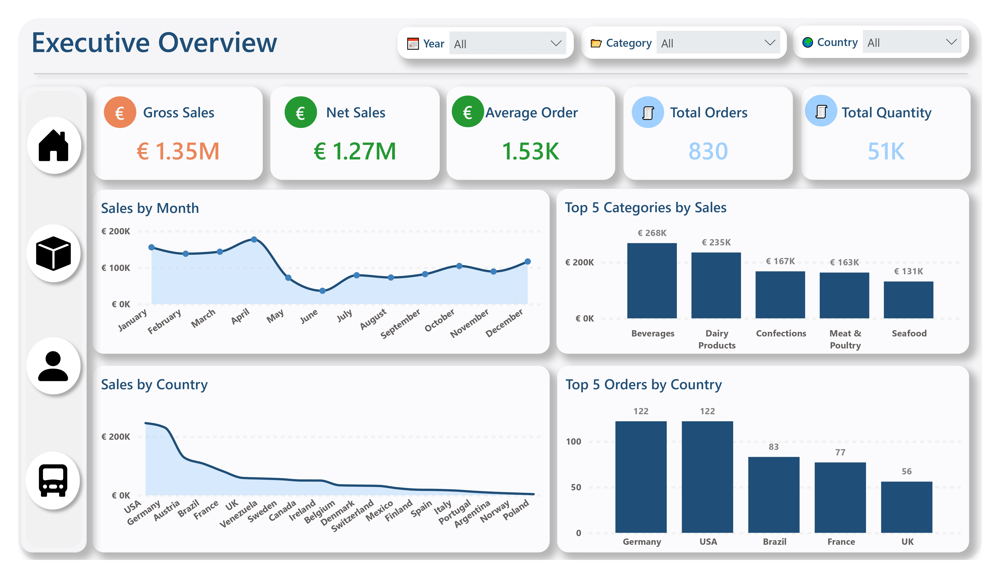
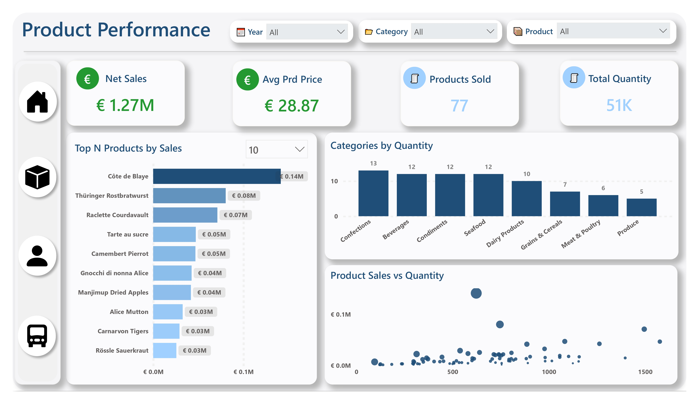
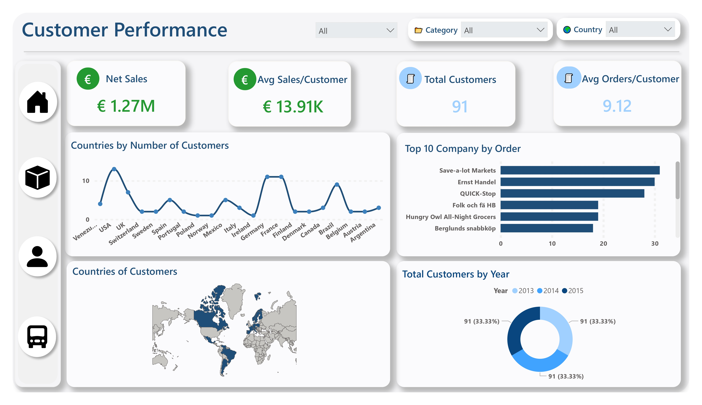
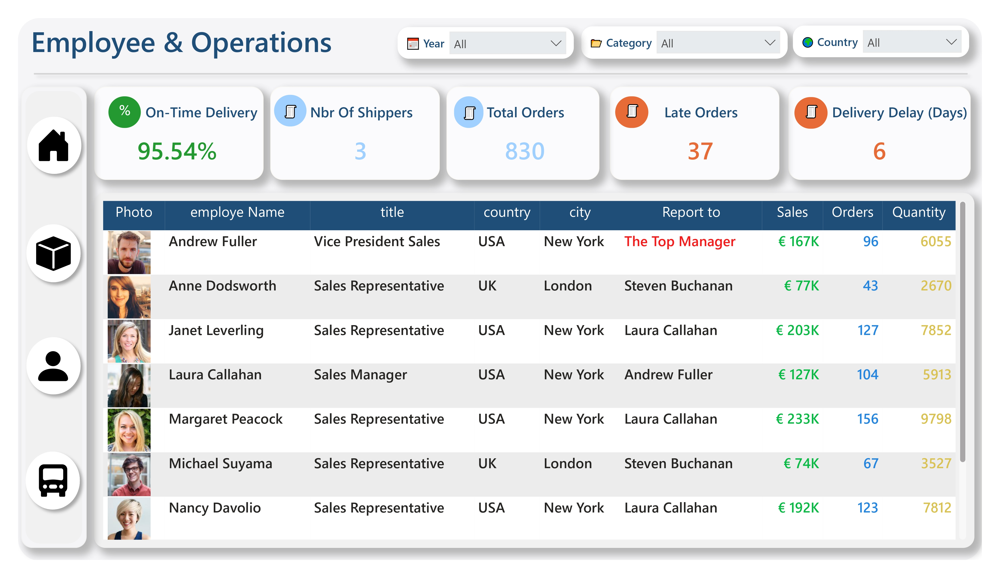

# Northwind Sales & Operations Analytics

Interactive Power BI dashboard for analyzing sales performance, products, customers, employees, and delivery operations using the Northwind dataset.

## Project Overview

This project presents an interactive Power BI dashboard designed to provide a comprehensive overview of sales and operational performance.

The dashboard is organized into four main views:

- **Executive Overview**
- **Product Performance**
- **Customer Performance**
- **Employee & Operations**

These views allow users to explore sales results, product performance, customer activity, employee performance, and delivery operations through interactive visualizations.

## Business Objectives

The main objectives of this dashboard are to:

- Monitor overall sales performance.
- Analyze gross and net sales.
- Track order volume and quantities sold.
- Analyze product and category performance.
- Identify top-performing products.
- Analyze customer performance and geographic distribution.
- Evaluate employee sales performance.
- Monitor delivery performance and delays.
- Compare business performance over time.

## Key Performance Indicators

The Executive Overview provides the following key metrics:

- **Gross Sales:** €1.35M
- **Net Sales:** €1.27M
- **Total Quantity:** 51K
- **Average Order:** €1.53K
- **Total Orders:** 830

## Product Performance

The Product Performance view focuses on product-level and category-level analysis.

It provides insights into:

- Total quantity sold.
- Net sales.
- Number of products sold.
- Average product price.
- Top-performing products.
- Sales by product.
- Quantity sold by category.
- Relationship between product sales and quantity.

The dashboard includes **77 products**.

## Customer Performance

The Customer Performance view provides insights into customer activity and sales contribution.

Key analysis areas include:

- Total customers.
- Average orders per customer.
- Average sales per customer.
- Top-performing customers.
- Customer sales by country.
- Customer distribution by country.
- Customer activity over time.

The dashboard includes **91 customers** and an average of **9.12 orders per customer**.

## Employee & Operations

The Employee & Operations view analyzes employee performance and delivery operations.

It provides insights into:

- Employee sales performance.
- Orders handled by employees.
- Quantity sold by employees.
- Delivery delays.
- On-time delivery rate.
- Late orders.
- Shipper performance.

Key operational indicators include:

- **Delivery Delay:** 6 days
- **On-Time Delivery:** 95.54%
- **Late Orders:** 37
- **Shippers:** 3
- **Total Orders:** 830

## Geographic & Time Analysis

The dashboard allows users to analyze sales and customer activity across different countries and over time.

Users can explore:

- Sales by country.
- Customer distribution by country.
- Monthly sales trends.
- Customer activity by year.
- Category performance over time.

## Data Source

The project includes the Northwind CSV dataset in the repository under:

```text
dataset/Northwind Traders/
```

The dataset contains:

- `categories.csv`
- `customers.csv`
- `employees.csv`
- `order_details.csv`
- `orders.csv`
- `products.csv`
- `shippers.csv`

Power Query uses the dataset included in the project, making the repository easier to reproduce on another machine.

## Tools & Technologies

- **Microsoft Power BI**
- **Power Query**
- **DAX**
- **Data Modeling**
- **Data Visualization**
- **Northwind Dataset**

## Dashboard Preview

### Executive Overview



### Product Performance



### Customer Performance



### Employee & Operations



## Project Structure

```text
northwind-sales-operations/
│
├── PowerBI/
│   └── Northwind_Sales_Operations.pbix
│
├── dataset/
│   └── Northwind Traders/
│       ├── categories.csv
│       ├── customers.csv
│       ├── employees.csv
│       ├── order_details.csv
│       ├── orders.csv
│       ├── products.csv
│       └── shippers.csv
│
├── screenshots/
│   ├── Northwind_Sales_Operations-1.jpg
│   ├── Northwind_Sales_Operations-2.jpg
│   ├── Northwind_Sales_Operations-3.jpg
│   └── Northwind_Sales_Operations-4.jpg
│
├── Northwind_Sales_Operations.pdf
│
└── README.md
```

## Key Insights

The dashboard makes it possible to analyze:

- Overall sales and order performance.
- Products and categories contributing most to sales.
- Customer performance and geographic distribution.
- Employee sales and operational performance.
- Delivery efficiency and late-order patterns.
- Changes in sales and customer activity over time.

## Project Context

This project was developed as part of my practical work in Data Analytics using Microsoft Power BI.

## Author

**Abderrahman El Harakani**

Master's Student in Data Science  
Data Analytics 

[LinkedIn](https://shorturl.at/nfMqM)
